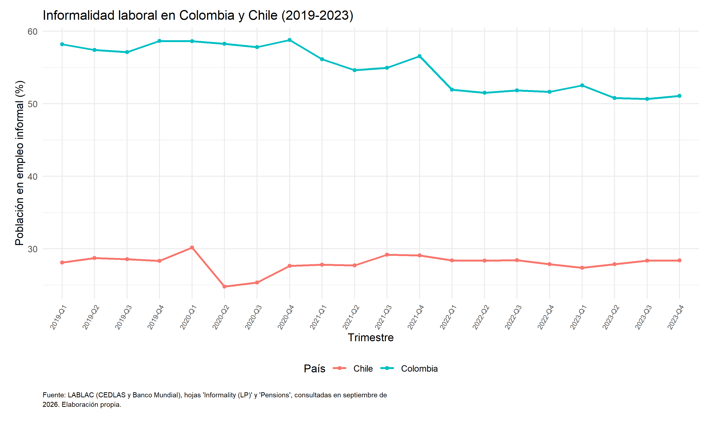
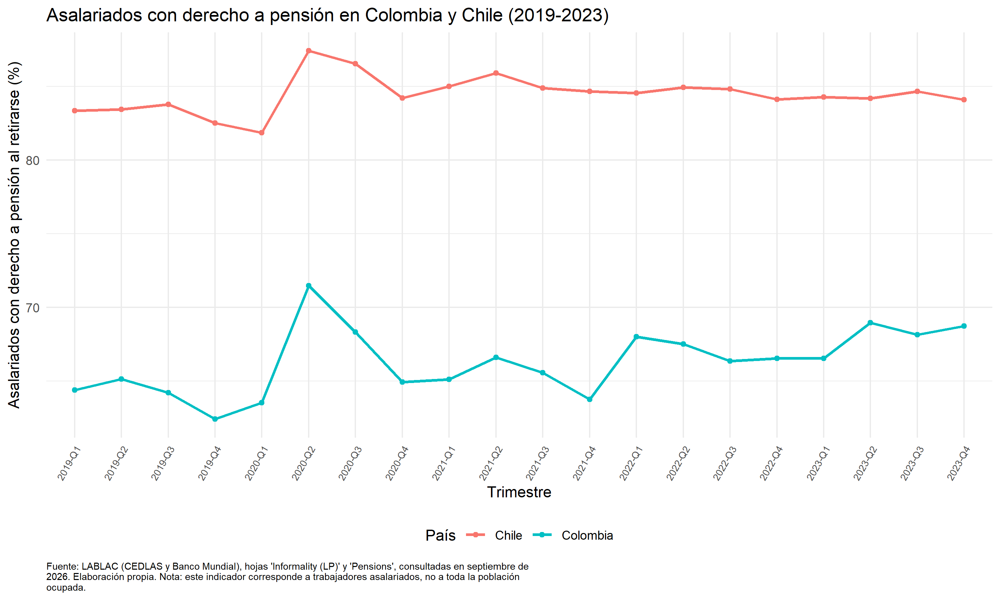
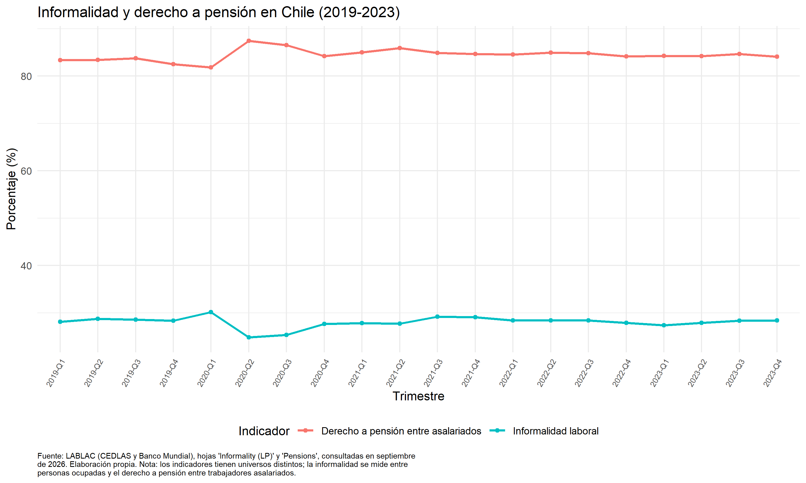
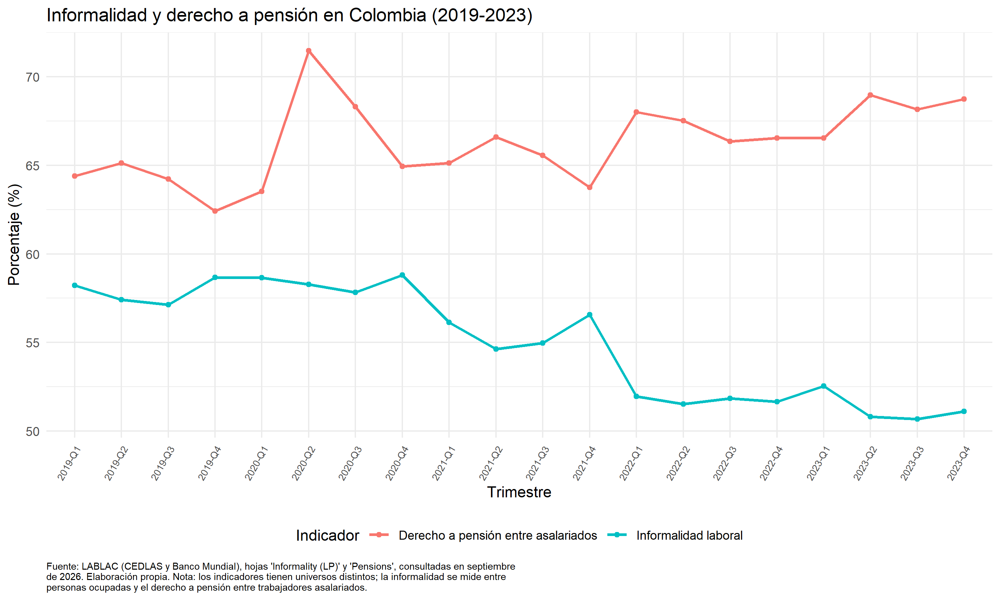

\begin{titlepage}
\centering
\vspace*{2cm}
{\Large\bfseries Informalidad laboral y derecho a pensión al retirarse: una comparación entre Colombia y Chile, 2019–2023\par}
\vspace{2cm}
Samuel Alberto Krohne Cabarique\\
Benjamin Velasquez Gutierrez\\
Jerónimo Montoya Alvarez
\vfill
Proyecto 1: Herramienta y App\\
EAFIT\\
2026
\end{titlepage}

# Introducción

La vejez es una etapa de la vida en la que las personas pueden enfrentar mayores necesidades económicas, por lo que contar con mecanismos de protección que permitan afrontar esta etapa resulta importante, entre ellos se encuentran los sistemas pensionales, cuyo funcionamiento depende tanto de las reglas que determinan su organización como de las condiciones del mercado laboral, especialmente de la estabilidad del empleo, los ingresos y la posibilidad de realizar cotizaciones. En este contexto, la informalidad laboral representa un aspecto relevante, ya que puede dificultar el acceso a la protección pensional y generar diferencias en las posibilidades que tienen los trabajadores de contar con una pensión al retirarse. [@melguizo2017].

Colombia y Chile constituyen dos casos de interés para analizar esta relación, pues, aunque ambos cuentan con sistemas pensionales que incluyen mecanismos contributivos, presentan diferencias en su organización y en las características de sus mercados laborales, lo que permite comparar si la relación entre informalidad laboral y protección pensional presenta patrones distintos entre los dos países. Para ello, se estudiará el periodo comprendido entre 2019 y 2023, con el propósito de observar el comportamiento de estos indicadores y reconocer posibles diferencias a lo largo del tiempo, teniendo en cuenta las particularidades de cada contexto nacional.

La elección de Chile como país de comparación responde al interés de analizar dos mercados laborales latinoamericanos que presentan diferencias en sus niveles de informalidad y en los indicadores de protección pensional. Aunque Perú y México también están incluidos en la base LABLAC, la comparación con Chile permite centrar el análisis en las diferencias entre Colombia y un país con menores niveles de informalidad y una mayor proporción de asalariados con derecho a pensión al retirarse, según los indicadores utilizados.

A partir de lo anterior, esta investigación busca responder la siguiente pregunta: ¿Qué relación existe entre la informalidad laboral y la proporción de trabajadores asalariados con derecho a pensión al retirarse en Colombia y Chile, y cómo difiere esta relación entre ambos países? Para responder, se realizará un análisis descriptivo con información trimestral de LABLAC (Labor Database for Latin America and the Caribbean), una base de datos que reúne indicadores del mercado laboral de países latinoamericanos, utilizando el indicador que mide la proporción de trabajadores asalariados con derecho a recibir una pensión al retirarse [@lablac], el cual permite aproximarse a esta dimensión de la protección pensional, aunque no mide directamente las cotizaciones efectivas ni la recepción actual de una pensión. El análisis abarca desde el primer trimestre de 2019 hasta el cuarto trimestre de 2023 y examinará la evolución de ambos indicadores, sus diferencias entre países y los patrones de asociación que puedan identificarse, sin asumir de antemano una relación causal entre las variables.

# Revisión de literatura

La cobertura de la protección social no depende únicamente de la existencia de instituciones y programas, sino también de las condiciones económicas, laborales y sociales que permiten a las personas acceder efectivamente a sus beneficios. Desde esta perspectiva, el análisis de la informalidad laboral y la cobertura pensional requiere considerar tanto el diseño de los sistemas de protección como las características del mercado laboral. @sojo2011, aunque estudia principalmente el acceso universal a la salud en América Latina, ofrece un marco conceptual útil al examinar la relación entre los derechos sociales, la protección social, las barreras de acceso y las restricciones financieras y políticas. Nos permite tener un panorama más contextual, se puede plantear que la existencia de un sistema institucional no garantiza por sí sola el acceso efectivo a la protección, pero no constituye evidencia directa sobre las cotizaciones o las pensiones de Colombia y Chile.

En relación con las condiciones del mercado laboral, @melguizo2017 presentan una conexión más directa con el problema de investigación. Su trabajo examina el estado de los mercados laborales y de la cobertura pensional en varios países de América Latina y el Caribe, y plantea alternativas para avanzar hacia una cobertura universal. Los autores vinculan la ampliación de la cobertura pensional con la reducción de la pobreza durante la vejez y con una agenda de promoción del empleo formal y del crecimiento de la productividad. Esta perspectiva es relevante para comparar Colombia y Chile, porque permite analizar la formalidad laboral no solo como una característica del empleo, sino también como una condición relacionada con la capacidad de contribuir a los sistemas pensionales. Sin embargo, dado que el artículo fue publicado antes del periodo estudiado, sus conclusiones sirven como fundamento analítico y no como una descripción de los resultados de 2019–2023.

La relación entre las características de los trabajadores y la probabilidad de cotizar se aborda de forma más específica en @cardona2022. Su investigación estudia los determinantes sociodemográficos de la cotización pensional en Colombia, Chile, México y Perú. Los autores concluyen que resolver problemas estructurales de los mercados laborales puede aumentar la probabilidad de cotización independientemente del sistema pensional, y destacan la importancia de la educación, la reducción de la deserción escolar y la formalización, especialmente entre los trabajadores independientes y por cuenta propia. Este trabajo resulta particularmente pertinente porque incluye los dos países de interés y se concentra en la decisión o probabilidad de cotizar, en lugar de abordar únicamente la estructura normativa de los sistemas.

En el caso colombiano, @samaniego2021 aportan evidencia empírica sobre la relación entre la regulación laboral y la formalización. El estudio evalúa una política implementada en 2014 que flexibilizó la contratación formal de trabajadores de tiempo parcial mediante la reducción de costos. A partir de datos administrativos de empleadores y empleados, los autores encuentran que la reforma aumentó  la probabilidad de ingresar al sector formal entre la población objetivo: trabajadores de bajos ingresos y de tiempo parcial. También identifican un aumento relativo de seis puntos porcentuales en el cambio del número total de trabajadores formales en las empresas que utilizaron los nuevos contratos, frente a las empresas de comparación, y una disminución temporal del salario diario medio. Aunque la reforma es anterior al periodo central de esta investigación, el estudio ayuda a explicar un mecanismo relevante: las condiciones y los costos de contratación pueden influir en la formalización y, por esa vía, en las oportunidades de realizar aportes a la seguridad social.

Otro aspecto importante es que la informalidad no se limita a una sola modalidad de empleo. @giraldo2019 analiza la economía colaborativa en Colombia y examina cómo el trabajo mediado por plataformas digitales plantea dificultades para clasificar las relaciones laborales y garantizar la protección de quienes prestan servicios. El artículo señala que la expansión de estas modalidades puede ocurrir más rápidamente que la adaptación de los marcos regulatorios y analiza la situación de trabajadores que aparecen formalmente como independientes, aunque su actividad pueda depender de las condiciones fijadas por las plataformas. Esta discusión amplía el análisis de la informalidad al mostrar que la relación entre trabajo, independencia contractual y protección social puede ser compleja.

La pandemia de COVID-19 constituye un punto de inflexión dentro del periodo 2019–2023. @acevedo2021 estudian la dinámica del mercado laboral latinoamericano durante la pandemia y documentan cambios en el empleo formal, el empleo informal, el desempleo y la inactividad. Para Colombia y Chile, los autores describen reducciones iniciales de la informalidad durante el segundo trimestre de 2020, en un contexto de fuertes restricciones a la actividad económica y aumentos de la inactividad; estos movimientos no deben interpretarse automáticamente como mejoras estructurales del empleo, ya que parte de la población salió temporalmente del mercado laboral. El estudio también plantea que, con la recuperación de la participación laboral, la informalidad podía volver a aumentar, esto es algo que resulta muy importante para el periodo estudiado porque permite reconocer que los indicadores laborales de 2020 estuvieron condicionados pues precisamente por el choque de la pandemia.

La discusión sobre la protección en la vejez también exige considerar las condiciones demográficas y económicas que sostienen los sistemas. @minoldo2017 cuestionan el uso exclusivo de indicadores de dependencia demográfica para medir los desafíos del envejecimiento y proponen prestar atención a la dependencia económica y a la capacidad efectiva de producir y distribuir recursos. Su análisis incluye a Chile, pero no a Colombia, por lo que su aporte a esta comparación es más informativo, esto también ayudará a evitar una interpretación exclusivamente demográfica de la sostenibilidad de las pensiones y permite incorporar las condiciones productivas y económicas.

Los documentos publicados en 2025 complementan el análisis desde una perspectiva posterior al periodo. @otero2025, en New Evidence on Labor and Firm Informality in Colombia, examinan los determinantes y consecuencias de la informalidad laboral y empresarial en Colombia, con atención a las diferencias regionales, educativas y demográficas, las características de las empresas y factores regulatorios como el salario mínimo, los impuestos a la nómina y los costos de formalización. El estudio señala que, según la GEIH, la informalidad laboral en 2023 alcanzó el 56 % a nivel nacional y el 43 % en las principales áreas urbanas así que se permite contextualizar el cierre del periodo de estudio.

Por su parte, @vergara2025 evalúa el efecto de la Pensión Garantizada Universal (PGU), implementada en Chile en 2022, sobre la participación laboral y la formalidad del empleo. Utilizando datos de la Encuesta Nacional de Empleo y de la Encuesta Casen 2022, el estudio analiza los primeros seis meses de implementación. Sus resultados indican que no se observa un efecto sobre la participación laboral ni la formalidad entre los beneficiarios directos, mientras que en hogares donde al menos un integrante es elegible se registra una reducción en ambas variables, especialmente entre los hombres. Este hallazgo permite incorporar una cuestión relevante para la comparación: las políticas no contributivas pueden mejorar la seguridad económica en la vejez, pero también conviene estudiar si generan efectos indirectos sobre las decisiones laborales de los hogares.

En conjunto, los nueve documentos permiten organizar el problema en tres dimensiones relacionadas. La primera es institucional y conceptual: la protección social depende tanto del diseño de los sistemas como de las condiciones que permiten acceder a sus beneficios. La segunda se concentra en el mercado laboral: la informalidad, las características sociodemográficas, la regulación y los costos de contratación se relacionan con las posibilidades de ingresar al empleo formal y contribuir a la seguridad social. La tercera incorpora las transformaciones del periodo 2019–2023, especialmente el choque laboral de la pandemia y la implementación de la PGU en Chile, así como evidencia publicada posteriormente que ayuda a interpretar esos cambios. Los estudios y documentos mencionados respaldan que se puede estudiar su relación con la informalidad laboral, pero no permite concluir, sin datos adicionales y comparables para ambos países, que un sistema pensional produzca necesariamente mejores resultados de cobertura que el otro. Por lo tanto, el análisis de 2019–2023 se apoyará en indicadores de informalidad laboral y de asalariados con derecho a pensión al retirarse, teniendo en cuenta las diferencias entre sus universos estadísticos, las particularidades de cada país y los posibles efectos del choque de la pandemia.

# Metodología y datos

Para analizar la relación entre la informalidad laboral y la cobertura del sistema pensional en Colombia y Chile, se utiliza una comparación de datos trimestrales para el periodo 2019-2023 de la fuente LABLAC, una base de datos desarrollada por el Centro de Estudios Distributivos, Laborales y Sociales (CEDLAS) y el Banco Mundial, que presenta indicadores del mercado laboral construidos a partir de encuestas de hogares de distintos países de América Latina.

Cada observación representa un país en un periodo determinado donde se incluye Colombia y Chile, con información desde el primer trimestre de 2019 hasta el cuarto trimestre de 2023, lo que corresponde a 20 trimestres por país y un total de 40 observaciones. Este periodo también permite, como se ha mencionado, ver el comportamiento de las variables antes, durante y después de la pandemia, lo cual es de gran ayuda.

Para realizar la comparación se utilizan dos indicadores, el primero corresponde a la informalidad laboral, tomado de la hoja Informality (LP) del archivo de empleo de LABLAC, bajo el indicador “Share of adults in informal jobs”. Según la definición de la base, este incluye a los trabajadores asalariados de empresas pequeñas, los trabajadores independientes no profesionales y los trabajadores sin ingresos. Para el análisis se utiliza la columna “Total", ya que el enfoque de la investigación es hacia un comportamiento general de la informalidad en cada país, aunque también se tiene información para separar los resultados por edad, género, educación o zona de residencia.

El segundo indicador se obtiene de la hoja “Pensions” del archivo de beneficios laborales de LABLAC, bajo el nombre “Share of salaried workers with right to pensions when retired”. Este mide la proporción de trabajadores asalariados que tienen derecho a una pensión al jubilarse y se utiliza como una aproximación a la cobertura pensional.

Es importante aclarar que no representa el porcentaje de toda la población que recibe una pensión ni permite conocer directamente si los trabajadores cotizan de manera continua durante su vida laboral. Por tanto, ambos indicadores tienen universos estadísticos distintos. El de informalidad incluye diferentes tipos de trabajadores ocupados, mientras que el indicador pensional se limita a los trabajadores asalariados. Por ejemplo, los trabajadores independientes informales pueden estar incluidos en el indicador de informalidad, pero no forman parte del universo del indicador pensional por no ser asalariados. En consecuencia, sus movimientos pueden compararse de forma descriptiva, pero no deben interpretarse como si midieran a la misma población ni como una relación directa entre la informalidad de cada trabajador y su derecho a pensión.

La información se organiza conservando el país, la encuesta, el periodo y el valor total de cada indicador. Posteriormente, ambas bases se unen utilizando el país, la encuesta y el trimestre como criterios de coincidencia. De esta manera, se obtiene una sola base que permite observar, para cada país y trimestre, tanto el nivel de informalidad laboral como el indicador pensional. Para Colombia se utiliza la Gran Encuesta Integrada de Hogares (GEIH), mientras que para Chile se utiliza la Encuesta Nacional de Empleo (NENE). Aunque ambas series provienen de LABLAC, corresponden a encuestas nacionales diferentes, por lo que esta característica debe tenerse en cuenta al comparar los resultados.

El análisis se desarrolla mediante la comparación de la evolución trimestral de los dos indicadores, su comportamiento a lo largo del periodo y las diferencias observadas entre Colombia y Chile. Esto permite identificar si los cambios en la informalidad laboral coinciden con cambios en el indicador pensional y si este comportamiento presenta diferencias entre los países. Sin embargo, debido a que se trabaja con datos agregados, los resultados permiten identificar patrones y relaciones entre las variables, pero no demostrar por sí solos una relación causal.

Fuente de los datos: LABLAC, CEDLAS y Banco Mundial. Archivos de empleo e informalidad y de beneficios laborales, versión consultada en septiembre de 2026.

# Resultados y análisis descriptivo

A partir de los datos recogidos de la fuente LABLAC se crearon cuatro gráficas: dos que comparan cada indicador entre los países y dos que muestran su evolución dentro de cada país. Además, se consideran los valores iniciales y finales y los promedios del periodo para identificar las principales diferencias y tendencias.

## Evolución de la informalidad laboral

{fig-cap="Informalidad laboral en Colombia y Chile (2019–2023)." width=100%}

La primera gráfica muestra una diferencia importante entre Colombia y Chile en los niveles de informalidad laboral durante el periodo estudiado. Colombia presenta porcentajes considerablemente superiores a los de Chile, lo que evidencia que la informalidad tiene una mayor presencia en el mercado laboral colombiano según la definición utilizada por LABLAC.

En Colombia primero de manera general vemos que la informalidad laboral pasó del 58,2 % en el primer trimestre de 2019 al 51,1 % en el cuarto trimestre de 2023, dejando una disminución de 7,1 puntos porcentuales y el promedio del indicador durante el periodo fue del 55,0 %. Ahora más específicamente la gráfica muestra que la reducción no se produjo de manera uniforme: durante 2019 y comienzos de 2020, la informalidad se mantuvo alrededor del 58 %, mientras que posteriormente presentó una tendencia general descendente, especialmente visible desde 2021 y durante 2022.

En Chile, por el contrario, el indicador presentó una evolución relativamente estable. La informalidad pasó del 28,1 % al 28,4 % entre el primer trimestre de 2019 y el cuarto trimestre de 2023, con un aumento de apenas 0,3 puntos porcentuales, y con un promedio del 28,0 %. Aunque se observan variaciones trimestrales, estas no modifican sustancialmente el nivel general del indicador.

## Evolución del indicador de derecho a pensión

{fig-cap="Asalariados con derecho a pensión al retirarse en Colombia y Chile (2019–2023)." width=100%}

La segunda gráfica compara la proporción de asalariados con derecho a pensión al retirarse en ambos países. En este indicador, Chile presenta niveles superiores a los de Colombia durante todo el periodo analizado.

En Chile, el indicador pasó del 83,4 % en el primer trimestre de 2019 al 84,1 % en el cuarto trimestre de 2023, lo que representa un aumento de 0,7 puntos porcentuales y teniendo un promedio del 84,5 %. La evolución trimestral muestra un comportamiento relativamente estable, aunque se observa un incremento temporal durante 2020, seguido de una estabilización en valores cercanos al 84 % y 85 %.

En Colombia, el indicador aumentó del 64,4 % al 68,7 % entre el inicio y el final del periodo, equivalente a un incremento de 4,3 puntos porcentuales con un promedio del 66,3   %. La gráfica muestra más variación que en Chile, incluido un aumento importante durante 2020, seguido de fluctuaciones en los trimestres posteriores.

Estos resultados muestran que, aunque Colombia presentó un aumento mayor en puntos porcentuales, Chile mantuvo una proporción superior de asalariados con derecho a pensión al retirarse, por tanto, es importante distinguir entre la evolución de un indicador y su nivel: un mayor incremento durante el periodo no significa necesariamente que un país haya alcanzado una cobertura superior al otro.

## Comparación entre informalidad laboral y derecho a pensión en Chile

Después de comparar cada indicador entre países, es pertinente examinar cómo evolucionaron conjuntamente la informalidad laboral y el indicador pensional dentro de Chile. Este análisis permite observar si ambas series presentaron cambios coincidentes durante determinados trimestres y si sus tendencias generales fueron similares o diferentes.

{fig-cap="Informalidad y derecho a pensión en Chile (2019–2023)." width=100%}

Se evidencia que la informalidad laboral registró un promedio del 28,0 %, mientras que el indicador de asalariados con derecho a pensión al retirarse alcanzó un promedio del 84,5 %. Además de la diferencia entre sus niveles, ambas series presentan comportamientos relativamente estables durante buena parte del periodo.

Alrededor de 2020 se observa una variación importante: la informalidad disminuyó temporalmente, mientras que el indicador pensional aumentó. Una posible explicación es que, durante la pandemia, los cambios en el empleo y la salida temporal de algunas personas del mercado laboral modificaran la composición de la población observada. Si los trabajadores que dejaron de estar ocupados tenían características diferentes de quienes permanecieron en el empleo asalariado, el porcentaje de asalariados con derecho a pensión podría aumentar sin que necesariamente se hubieran generado nuevos derechos pensionales. Sin embargo, con los indicadores disponibles no es posible comprobar que este mecanismo explique los cambios observados.

En consecuencia, para Chile, el principal hallazgo descriptivo es que hay niveles relativamente bajos de informalidad y una proporción elevada de asalariados con derecho a pensión al retirarse, acompañada de una evolución generalmente estable entre 2019 y 2023.

## Comparación entre informalidad laboral y derecho a pensión en Colombia

{fig-cap="Informalidad y derecho a pensión en Colombia (2019–2023)." width=100%}

La cuarta gráfica muestra la evolución de las dos variables en Colombia, que a diferencia de Chile, se observa una reducción más marcada de la informalidad laboral y un aumento del indicador de asalariados con derecho a pensión al retirarse entre los valores iniciales y finales del periodo.

La informalidad pasó del 58,2 % al 51,1 %, mientras que el indicador pensional aumentó del 64,4 % al 68,7 %. Esta evolución representa una disminución de 7,1 puntos porcentuales en la informalidad y un incremento de 4,3 puntos porcentuales en el indicador pensional.

La gráfica permite observar que, durante algunos trimestres, las variables presentan movimientos que parecen llevar a una reducción de la informalidad y un aumento del indicador pensional, sin embargo el comportamiento no es igual en todos los trimestres.

También se observó un aumento del indicador pensional durante 2020. Durante la pandemia, los cambios en el empleo pudieron modificar la composición de los trabajadores asalariados observados. Si algunas personas dejaron temporalmente de estar ocupadas y, por tanto, de formar parte de la población considerada en el indicador, la proporción registrada podría aumentar sin que esto implicara necesariamente la adquisición de nuevos derechos pensionales o un incremento de las cotizaciones efectivas. Sin embargo, se necesitan más indicadores para confirmar esta posibilidad.

El principal resultado descriptivo para Colombia es que los dos indicadores evolucionaron favorablemente en términos de sus valores iniciales y finales, disminuyó la informalidad y aumentó la proporción de asalariados con derecho a pensión al retirarse, pero, el país continuó presentando niveles de informalidad superiores a los de Chile y un indicador pensional inferior al chileno al finalizar 2023.

## Principales hallazgos y comparación entre países

La comparación de los indicadores permite identificar diferencias entre Colombia y Chile durante el periodo 2019–2023. En términos generales, Colombia presentó mayores niveles de informalidad laboral y una menor proporción de asalariados con derecho a pensión al retirarse. Chile mantuvo menores niveles de informalidad y una mayor proporción de asalariados con derecho a pensión al retirarse, mientras que la evolución de ambos indicadores fue relativamente estable durante el periodo. Sin embargo, estas diferencias deben entenderse a partir de los indicadores seleccionados y no como una medida completa de la protección pensional de cada país.

Al observar la evolución de las series dentro de cada país, en Colombia la disminución de la informalidad coincidió con un aumento del indicador pensional. En Chile, por su parte, ambos indicadores presentaron variaciones más reducidas entre el inicio y el final del periodo. Esto permite identificar comportamientos diferentes, aunque no demuestra que los cambios en la informalidad hayan producido cambios en el derecho a pensión.

También es necesario considerar las particularidades de los datos. La informalidad incluye distintas categorías de trabajadores ocupados, mientras que el indicador pensional se limita a los asalariados. Además, la información procede de encuestas nacionales diferentes: la GEIH en Colombia y la NENE en Chile. Estas diferencias aconsejan prudencia al comparar los niveles de ambos países y al interpretar los movimientos de las series.

Por último, los cambios observados durante 2020 deben analizarse en el contexto de la pandemia. Como señalan @acevedo2021, durante este periodo se produjeron alteraciones importantes en el empleo, el desempleo y la inactividad laboral en América Latina. En consecuencia, una variación en los indicadores pudo reflejar cambios en la composición de la población observada, además de posibles cambios en las condiciones laborales. No obstante, los datos utilizados en esta investigación no permiten comprobar que este mecanismo explique por sí solo los movimientos registrados.

En conjunto, los resultados ofrecen una descripción de las diferencias y de la evolución de ambos indicadores en Colombia y Chile. Aunque sus movimientos coincidieron en cierta medida en Colombia, no es posible establecer una relación causal entre la informalidad laboral y el derecho a pensión al retirarse a partir de estas series agregadas.

# Implicación de política

Los resultados de esta investigación pueden servir como punto de partida para quienes diseñan políticas de formalización laboral y protección pensional en Colombia. Al finalizar 2023, el país registró una informalidad laboral del 51,1 %, frente al 28,4 % de Chile. Además, el indicador de asalariados con derecho a pensión al retirarse fue del 68,7 % en Colombia y del 84,1 % en Chile. Estas diferencias muestran que todavía existen desafíos importantes en materia de formalización y protección pensional en Colombia, aunque la comparación por sí sola no permite identificar las causas de esta brecha.

A partir de estos resultados, sería pertinente evaluar medidas que faciliten la formalización de los trabajadores independientes y de bajos ingresos, teniendo en cuenta sus condiciones laborales, la irregularidad de sus ingresos y los costos de cotización. Para quienes diseñan estas políticas, no basta con medir si disminuye la informalidad: también es importante examinar si aumenta la afiliación, si los trabajadores mantienen sus cotizaciones a lo largo del tiempo y si mejoran sus posibilidades de acceder a la protección pensional al retirarse.

La experiencia de Chile puede servir como referencia para formular preguntas y orientar futuras evaluaciones, pero no permite concluir que sus políticas sean directamente aplicables a Colombia ni que expliquen por sí solas las diferencias observadas. Para determinar qué medidas funcionan mejor, se necesitan análisis adicionales que consideren las características de los trabajadores, las condiciones del mercado laboral y las diferencias entre los sistemas pensionales. De esta manera, los resultados de esta investigación pueden contribuir a identificar desafíos y orientar evaluaciones de política pública, sin asumir que una reducción de la informalidad garantiza automáticamente una mayor protección pensional.

# Conclusiones

La comparación entre Colombia y Chile durante el periodo 2019–2023 permite identificar diferencias importantes en la informalidad laboral y en la proporción de asalariados con derecho a pensión al retirarse. Colombia presentó mayores niveles de informalidad y un menor indicador pensional que Chile. Sin embargo, la evolución de los indicadores fue diferente: en Colombia disminuyó la informalidad y aumentó la proporción de asalariados con derecho a pensión, mientras que en Chile ambos indicadores presentaron cambios más reducidos.

En respuesta a la pregunta de investigación sobre la relación entre la informalidad laboral y el indicador pensional, los resultados permiten describir diferencias entre los dos países y observar la evolución de ambos indicadores, pero no establecer que la disminución de la informalidad haya causado un aumento del indicador pensional. Asimismo, los cambios observados durante 2020 deben interpretarse teniendo en cuenta el contexto de la pandemia, que pudo modificar la composición de la población ocupada y asalariada incluida en las mediciones, sin que los datos disponibles permitan confirmar esta explicación. Otros factores, como la tasa de desempleo, la estabilidad de los ingresos, las características de los trabajadores y el diseño de los sistemas pensionales, también podrían influir en las diferencias observadas.

Por tanto, para comprender mejor esta relación, sería necesario incorporar información adicional sobre las características de los trabajadores, la continuidad de las cotizaciones y las diferencias entre los sistemas pensionales de ambos países. Asimismo, los estudios revisados sobre formalización y cotización ofrecen elementos para analizar cómo las condiciones de vinculación laboral pueden influir en las posibilidades de acceder a la protección pensional [@melguizo2017; @cardona2022].

# Referencias

::: {#refs}
:::
# Declaración de uso de inteligencia artificial

Para la elaboración de este proyecto se utilizó ChatGPT como herramienta de apoyo para la organización de ideas, la revisión de la redacción, en la  búsqueda de fuentes, que posteriormente fueron revisadas por los autores, y en la clasificación de los resultados obtenidos a partir de los datos de LABLAC. Su uso también contribuyó a mejorar la claridad y estructura. La selección de las variables, la revisión de las fuentes, la interpretación final de los resultados y la responsabilidad sobre el contenido presentado corresponden a los autores.
